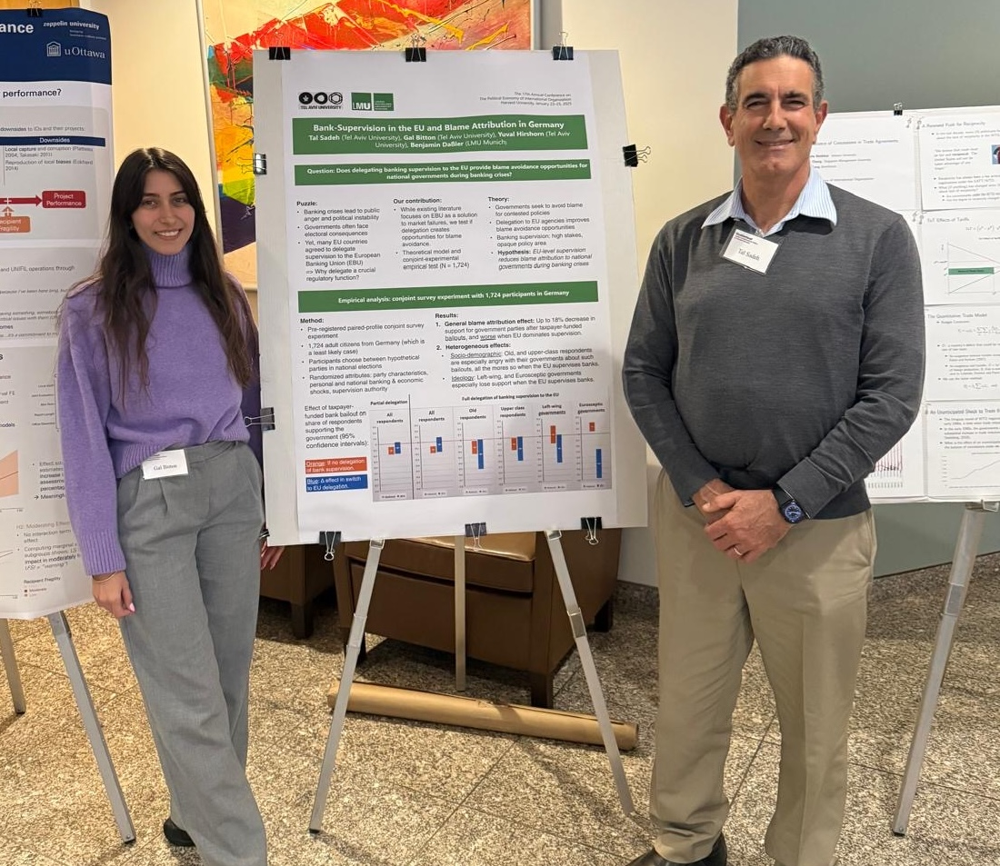
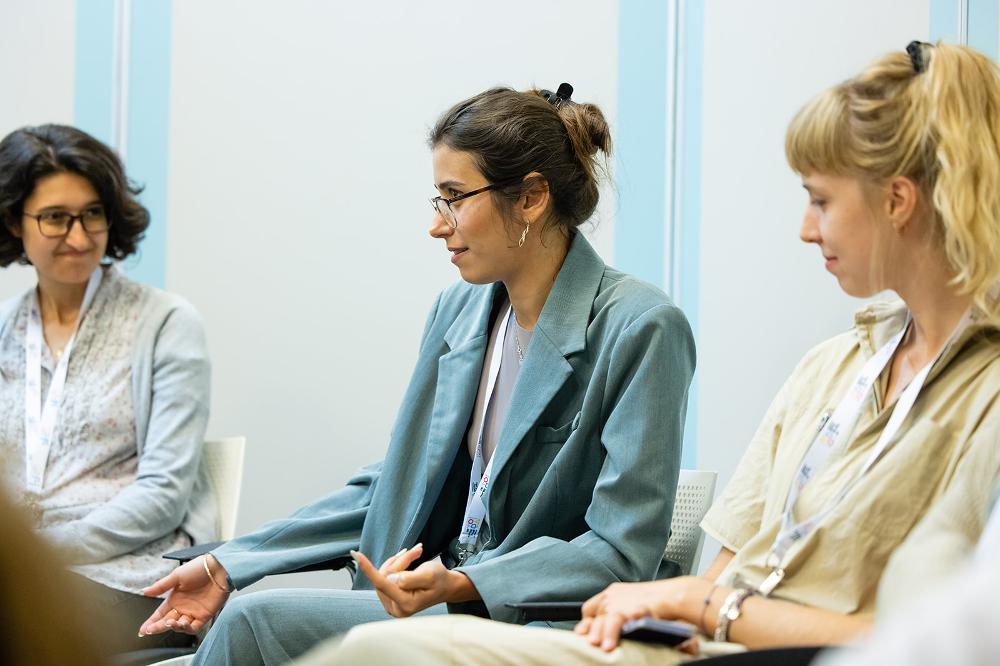
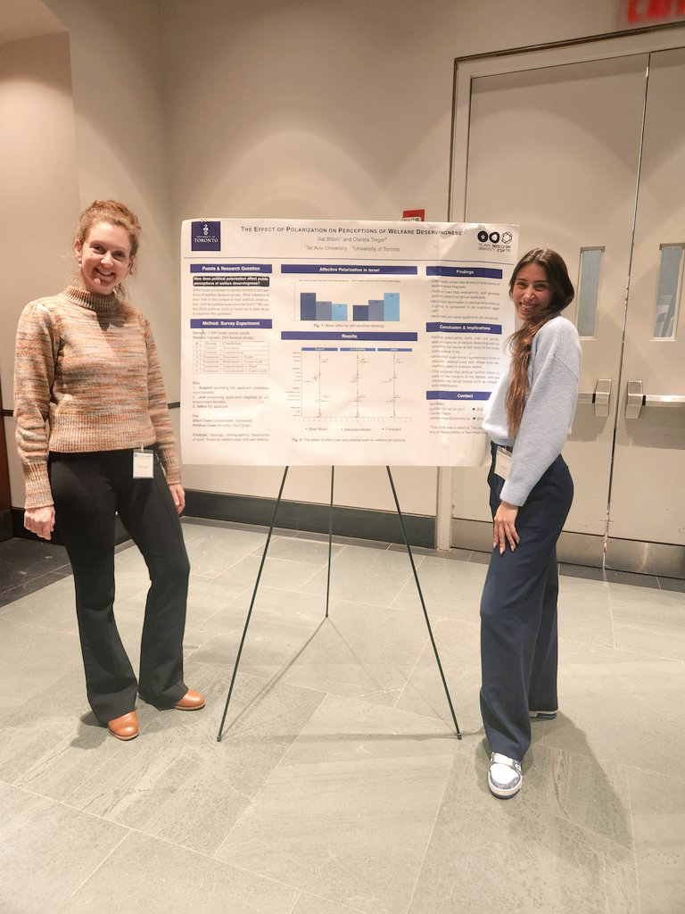
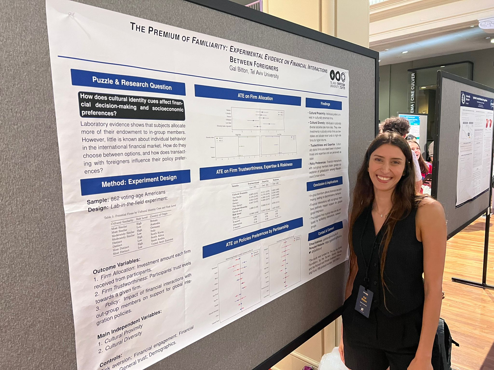
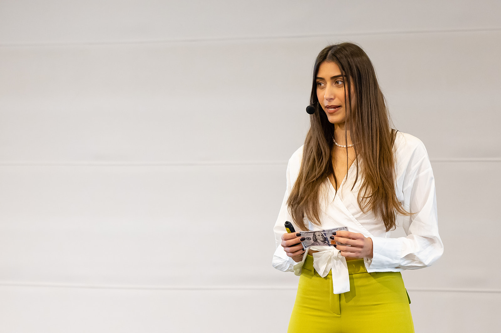
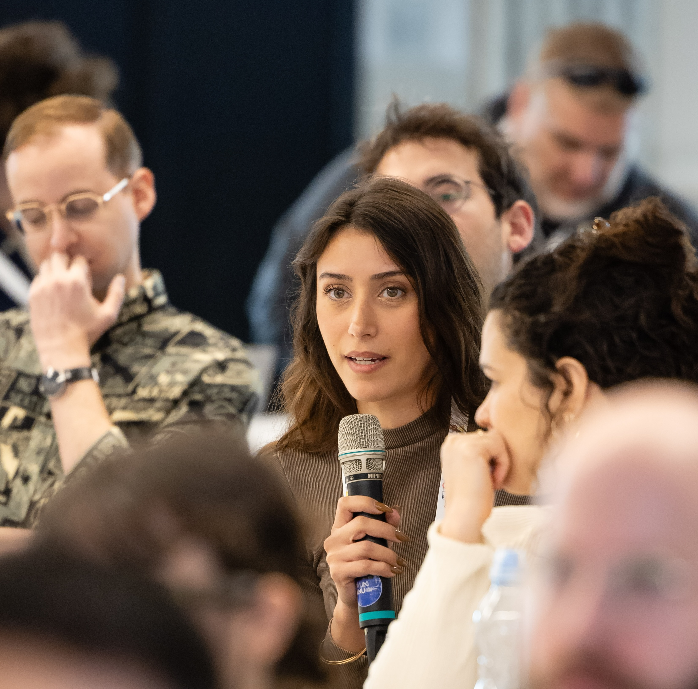

Hello!

I am a postdoctoral researcher at the [Mossavar Rahmani Center for Business and Government (M-RCBG) at Harvard Kennedy School of Government](https://www.hks.harvard.edu/centers/mrcbg). I am also a fellow at the [Institute for Quantitative Social Science (IQSS)](https://www.iq.harvard.edu) and the [Center for American Political Studies (CAPS)](https://caps.gov.harvard.edu). Previously, I was a postdoctoral researcher at the [Weatherhead Center for International Affairs](https://www.wcfia.harvard.edu/people/gal-bitton) at Harvard University. I earned my PhD in Political Science from Tel Aviv University in February 2025, during which I was awarded a Graduate Fellowship from the [Azrieli Foundation](https://azrielifoundation.org/fellows/directory/). In Spring 2027, I will join the Department of International Relations at The Hebrew University of Jerusalem as a Lecturer (equivalent to an Assistant Professor). 

My research lies primarily in **international political economy**, with a focus on the political and psychological foundations of economic decision-making and policymaking. I study how cultural identities, political preferences, and institutional arrangements shape financial openness, cross-border economic interactions, and attitudes toward economic redistribution. An important part of my work also examines **welfare preferences and perceptions of deservingness**, exploring how social identities, political considerations, and perceptions of different groups shape public support for redistribution and social policies. My research bridges individual-level behavior and broader political and economic outcomes, examining how citizens' perceptions and decisions interact with national and international institutions.

Alongside my work in PE, I study **polarization, political violence, and anti-democratic attitudes**, focusing on how political identities, perceived threats, and exposure to conflict shape political trust, democratic attitudes, electoral behavior, and support for political violence.  I am also interested in identifying and evaluating interventions aimed at reducing such negative attitudes and behavior. Across these areas, I seek to understand how individuals respond to political and economic threats, how these responses are shaped by institutional and political contexts, and how they can be mitigated.

Relatedly, I co-organize the [Democracy and Political Violence Collaborative](https://dpvconf.com/) with Sum Fuller and Jack T. Rametta, an interdisciplinary initiative bringing together scholars studying political violence, democratic resilience, and antidemocratic attitudes through conferences, workshops, and research exchanges.

My research adopts a comparative perspective and combines experimental and observational methods, survey design, and computational approaches, including the use of large language models (LLMs) for predictive modeling.

---

## 📸 

Here are some key moments captured on camera:

    

        
        
<em>Presenting at PEIO 2025.</em>

    

    

        
        
<em>Azrieli Forum.</em>

    

    

        
        
<em>Presenting at the 2024 Rebecca B. Morton Conference.</em>

    

    

        
        
<em>Presenting at PolMeth 2024.</em>

    

    

        
        
<em>Azrieli Forum.</em>

    

    

        
        
<em>Azrieli Forum.</em>

    

